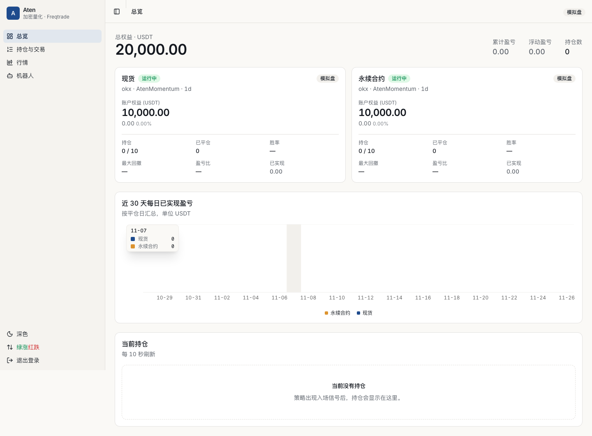
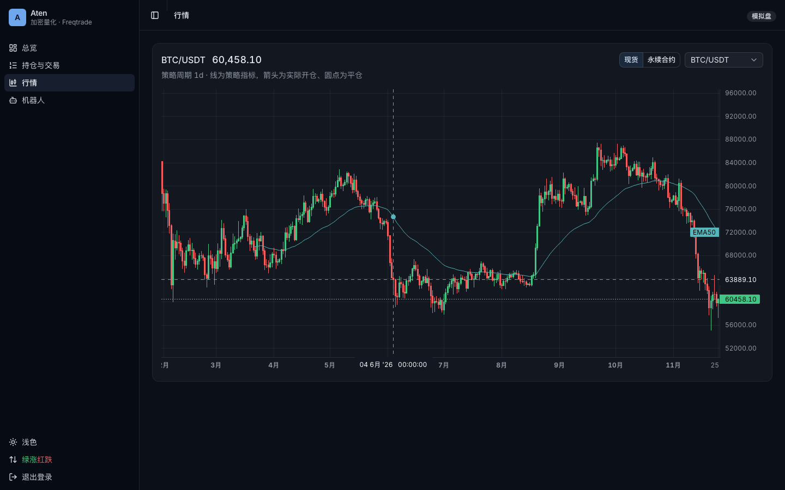
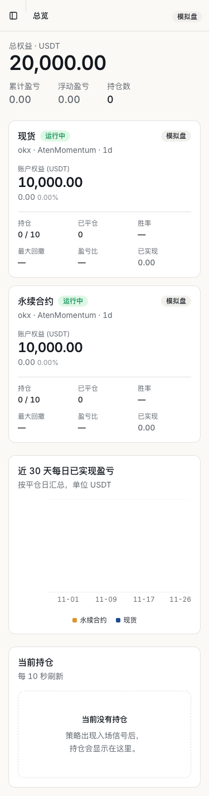

<div align="center">

# Aten

**基于 Freqtrade 的加密货币量化交易系统 —— 现货 + 永续合约、中文 Web 控制台、QQ 群推送**

[](LICENSE)


[功能](#功能) · [快速开始](#快速开始) · [策略](#策略) · [部署](#生产部署) · [实盘清单](#上实盘前检查清单) · [致谢](#致谢)

</div>

---

Aten 是 A 股量化系统 [Quanti](https://github.com/coo-moon/quanti) 的加密货币姊妹项目。交易引擎直接使用成熟的开源项目 [Freqtrade](https://github.com/freqtrade/freqtrade)（官方 Docker 镜像，不修改源码，可随上游升级），在其之上补齐：

- 经过**预先登记、样本外检验**的生产策略 `AtenMomentum`
- 面向中文用户的 **Web 控制台**（React + shadcn/ui，沿用 Quanti「研报纸面」视觉）
- **QQ 群推送**：开平仓成交、机器人异常、每日日报
- 只监听回环地址、不干扰同机其他服务的**生产部署方案**

> [!WARNING]
> 加密货币交易风险极高，可能损失全部本金。本项目仅供学习研究，回测与模拟盘收益不代表未来表现，不构成任何投资建议。



## 功能

| 模块 | 说明 |
|------|------|
| 交易引擎 | 两个 Freqtrade 机器人：现货、永续合约（逐仓 1 倍），默认 dry-run 模拟盘自动交易，起步资金合计 10,000 USDT（各 5,000）；交易所端止损单兜底 |
| 生产策略 | `AtenMomentum`：日线时序动量 + 只做多 + BTC 200 日均线牛熊过滤 + 波动率风险平价仓位 |
| 研究工具 | 训练期 / 样本外回测脚本、**逐日盯市**夏普与回撤（修正 Freqtrade 平仓口径的偏差）、参数敏感性扫描 |
| Web 控制台 | 总览（权益 / 每日盈亏 / 持仓）、持仓与交易（可市价平仓，二次确认）、K 线（指标 + 成交标记）、机器人启停 |
| 体验细节 | 深浅色主题、绿涨红跌 / 红涨绿跌一键切换、移动端适配、实盘时顶栏醒目红色提示、页面按需加载 |
| QQ 推送 | 开平仓成交、启动 / 异常、连续 5 分钟离线与恢复、每天 08:15「每日决策」（BTC 牛熊、各币信号与操作原因、权益与持仓）；同一事件只推一次 |
| 安全 | 密钥只走 `.env`；API 只绑 `127.0.0.1`；HTTPS + HSTS + 严格 CSP；登录接口限流 |

<details>
<summary>更多截图</summary>

| K 线（深色） | 移动端 |
|---|---|
|  |  |

</details>

## 架构

```text
                     ┌──────────────── 服务器（只监听 127.0.0.1）────────────────┐
 浏览器 ── HTTPS ──▶ nginx ─┬─ /            静态控制台 web/dist                    │
                     │      ├─ /ft/spot/    ─▶ Freqtrade 现货机器人   :18701      │
                     │      └─ /ft/futures/ ─▶ Freqtrade 永续机器人   :18702      │
                     │                              │ webhook                      │
                     │                              ▼                              │
                     │                       aten-notifier :18703 ── 探活 / 日报   │
                     │                              │                              │
                     └──────────────────────────────┼──────────────────────────────┘
                                                    ▼
                                    QQ 机器人推送入口 ──▶ QQ 群
```

## 快速开始

**环境要求**：Docker（含 Compose v2）、Node.js 20.19+ / 22.12+。

```bash
git clone https://github.com/MilkFoam-L/aten.git
cd aten
cp .env.example .env            # 修改 API 密码、JWT 密钥
docker compose up -d            # 启动现货 / 永续机器人（dry-run）与推送服务

cd web
npm install
npm run dev                     # http://localhost:5173 ，用 .env 中的账号登录
```

开发时 Vite 会把 `/ft/<bot>/*` 代理到对应机器人（见 `web/vite.config.ts`），无需配置 CORS。

> [!NOTE]
> 部分地区 IP 无法访问 Binance / Bybit。可在 `.env` 设置 `FREQTRADE__EXCHANGE__NAME=okx` 改用 OKX。

## 策略

`AtenMomentum`（`user_data/strategies/research.py`）的完整研究过程、失败的候选与已知风险见 **[策略研究报告](docs/strategy-research.md)**。摘要如下：

| 样本外 2024-07 ~ 2026-11（市场 -28.9%），逐日盯市 | 夏普 | 年化 | 最大回撤 | 盈亏比 |
|---|---|---|---|---|
| 永续 | 1.16 | 27.0% | 22.5% | 2.60 |
| 现货 | 1.19 | 28.2% | 22.3% | 2.65 |

- 利润高度集中在牛市（2024 年），熊市空仓不赚钱；BTC 低于 200 日均线时机器人**空仓等待是正常行为**。
- 回测费用按永续 0.06% / 现货 0.11% 每边计算。

复现回测：

```bash
scripts/bt.sh 20240701-20261126 AtenMomentum | python3 scripts/bt-summary.py   # Freqtrade 口径
scripts/bt-export.sh 20240701-20261126 AtenMomentum                              # 逐日盯市口径
```

## QQ 群推送

推送服务 `notifier/aten_notifier.py` 只依赖 Python 标准库，复用 Freqtrade 镜像运行。消息发往 QQ 机器人的 Aten 专用入口，**目标群由机器人侧配置**，本项目无法指定群号。

| 环境变量 | 说明 |
|----------|------|
| `ATEN_QQ_PUSH_URL` | 推送入口，只允许 `https://` 或本机回环地址 |
| `ATEN_QQ_PUSH_TOKEN` | 与机器人侧 `ATEN_NOTIFICATION_TOKEN` 一致 |
| `ATEN_DAILY_REPORT_HOUR` | 每日决策推送时间（北京时间，默认 8，即 08:15，日线收盘下单之后） |

两项缺一则不推送；推送失败只记录日志，不影响交易。

消息格式对齐 Quanti：先标明模拟盘 / 实盘，再写成交时间、数量与价格、仓位如何计算，原因里给出触发信号的具体数值和策略名。示例：

```text
机器人买入 SOL
【模拟盘·非真实交易】买入 SOL/USDT · 现货
11/27 08:01 成交：3.2145 个 @ 150.23，金额 482.90 USDT
仓位：占权益 9.7%（按 30 日年化波动率 36% 风险平价：3.5% ÷ 36% = 9.7%）
原因：30 日涨幅 +12.3%；收盘 150.23，EMA50 141.10，高于均线 +6.5%；BTC 在 200 日均线上方 +4.2% · AtenMomentum 日线动量
账户：权益 4,982.00 USDT，持仓 3/10
```

| 消息 | 时机 | 内容 |
|------|------|------|
| 开仓 / 平仓 | 成交后即时 | 数量、价格、金额、仓位计算、信号数值、这笔收益与账户盈亏（平仓） |
| 撤单 | 限价单 10 分钟未成交 | 撤单价格、原因、后续处理 |
| 每日决策 | 每天 08:15 | 市场状态、当日操作明细、10 个币的信号与判定原因、账户与持仓、体检 |
| 启动 | 机器人启动 | 策略规则、资金、持仓上限、止损、交易所 |
| 异常 / 离线 / 恢复 | 发生时 | 内容与下一步操作；同类告警 10 分钟内只发一次 |

## 生产部署

`deploy/` 提供宿主机网络 + 回环端口的 Compose 文件和 nginx 站点配置，只占用 `/opt/aten` 与 `/etc/nginx/conf.d/aten.conf`，不修改服务器上的其他配置。

```bash
# 1. 服务器上创建 /opt/aten/.env（参考 .env.example）
# 2. 首次签发证书（webroot 方式，不让 certbot 改写 nginx 配置）
certbot certonly --webroot -w /var/www/html -d aten.example.com
# 3. 本地一键构建、同步、启动
SSH_HOST=root@<服务器> DOMAIN=aten.example.com deploy/deploy.sh
```

| 端口（仅 127.0.0.1） | 服务 |
|---|---|
| 18701 | 现货机器人 API |
| 18702 | 永续机器人 API |
| 18703 | 推送服务 |

## 上实盘前检查清单

- [ ] 模拟盘至少观察数周，确认开平仓与回测逻辑一致、QQ 推送正常
- [ ] 交易所 API Key **只开「读取 + 交易」，绝不开「提现」**，并绑定服务器 IP 白名单
- [ ] 确认交易所服务条款允许你所在地区与服务器 IP 使用
- [ ] 在 `.env` 填写 `FREQTRADE__EXCHANGE__KEY / SECRET`（OKX 还需 `PASSWORD`）
- [ ] 在 `user_data/config.base.json` 把 `dry_run` 改为 `false`，并设置 `available_capital` 限制机器人可用资金（建议先小额）
- [ ] 重启后控制台顶栏应显示红色「● 实盘」，QQ 启动消息显示「实盘」

## 目录结构

```text
aten/
├── docker-compose.yml          # 本地开发：机器人 + 推送服务
├── user_data/
│   ├── config.base.json        # 公共配置（dry-run、风控、webhook）
│   ├── config.spot.json        # 现货交易对
│   ├── config.futures.json     # 永续交易对（逐仓）
│   ├── config.research.json    # 研究回测覆盖项
│   └── strategies/research.py  # 候选策略与生产策略 AtenMomentum
├── notifier/                   # QQ 推送服务（标准库）+ 单元测试
├── web/                        # React + shadcn/ui 控制台
├── scripts/                    # 回测、逐日盯市、指标汇总脚本
├── deploy/                     # 生产 Compose、nginx 配置、部署脚本
└── docs/                       # 策略研究报告与截图
```

## 开发

```bash
cd web && npm run lint && npm run build              # 前端类型检查、lint、构建
python3 -m unittest discover -s notifier -p 'test_*.py'   # 推送服务单元测试
```

提交信息遵循 [Conventional Commits](https://www.conventionalcommits.org/zh-hans/)。

## 许可证

本项目以 [GPL-3.0](LICENSE) 协议开源。策略代码直接依赖 Freqtrade（GPL-3.0），因此沿用相同协议。

## 致谢

- [freqtrade/freqtrade](https://github.com/freqtrade/freqtrade) —— 交易引擎（GPL-3.0），本项目以官方 Docker 镜像使用，未修改其源码
- [shadcn/ui](https://github.com/shadcn-ui/ui) —— 控制台组件
- [TradingView Lightweight Charts](https://github.com/tradingview/lightweight-charts) —— K 线图表
- [Quanti](https://github.com/coo-moon/quanti) —— 姊妹项目（A 股），视觉风格来源

**原仓库**：本项目基于 [freqtrade/freqtrade](https://github.com/freqtrade/freqtrade) 构建。
